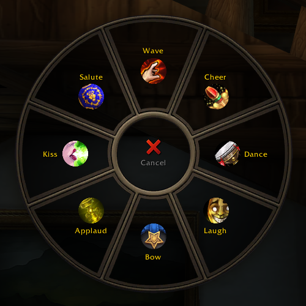
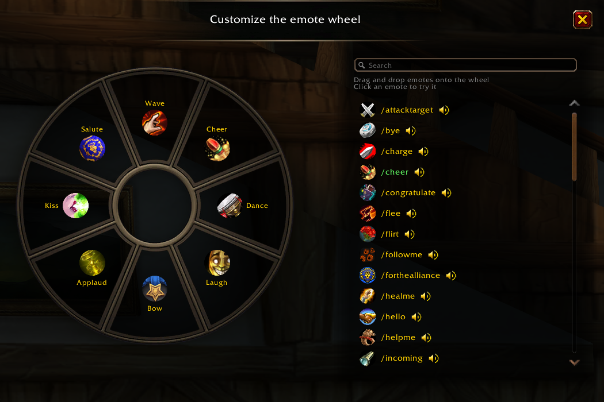
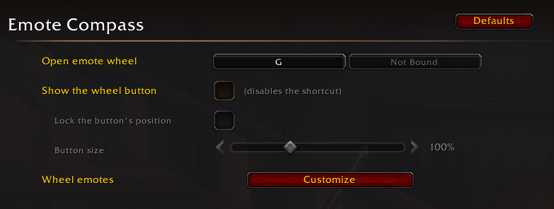
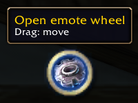

<div align="center">



# 🎭 Emote Compass

A radial emotes wheel on one key that mimics the one from the controller UI.


</div>


## 📦 Install

Copy the `EmoteCompass` folder into `World of Warcraft/_<version>_/Interface/AddOns/`.

## 🎮 Usage

Hold `G` to open the wheel under the cursor, point at a wedge and release the key. Left click also picks an emote. Right click or Escape cancels. You can rebind the key in the game's keybinds list.

- `/ec` opens the options.
- `/ec edit` opens the wheel editor.
- `/ec show` opens the wheel and keeps it open until you pick an emote or cancel.

### 🎨 Customize the wheel

Drag an emote from the list onto a wedge to assign it. Drag between wedges to swap them, or drag a wedge off the wheel to clear it. Click an emote to try it.



### ⚙️ Options

The options page is under Esc > Options > AddOns. It shows the bound key, opens the editor, and can show a small button that opens the wheel on click. While the button is shown, the key is disabled. You can drag the button, lock its position and resize it.





## 🛠️ Stack

The addon is plain Lua with a few XML files and no external libraries.

- The wheel reuses the art and geometry of Blizzard's gamepad radial menu.
- The emote list is built at runtime from the game's `EMOTE<n>_TOKEN` and `EMOTE<n>_CMD1` globals. Labels come from the client's translated slash commands, so they follow the game language. Icons are picked by hand in `Data/EmoteData.lua`.
- The options page uses the Settings API, with one XML template for the checkbox hint.
- The editor list uses `WowScrollBoxList` and a data provider.
- The wheel layout and button settings are saved in the account-wide `EmoteCompassDB`.
- The interface text is translated into 10 languages in `Core/Locale.lua`.

```
Core/    constants, text, helpers, saved data, emote catalog
Data/    icon for each emote
UI/      wheel view, popup, editor, wheel button, options
Init.lua key binding, slash commands, startup
```
